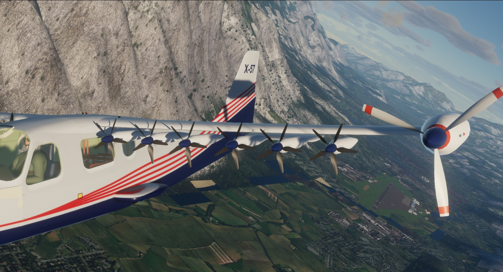

# X-57 Maxwell for FlightGear, with a JSBSim model

A JSBSim flight model of NASA's X-57, the battery-electric demonstrator built on a Tecnam P2006T fuselage, in its Mod III
(a new high-aspect-ratio wing with cruise motors at the tips) and Mod IV (twelve high-lift propellers added along the
leading edge) forms. It is modelled from NASA's public data and is not made or endorsed by NASA or Tecnam.

**Status: production (FDM 5, systems 4, cockpit 4, model 4). A built-up model, part by part, flies in JSBSim and FlightGear on NASA's CFD, with all fourteen propellers, their motors, the cruise governor and
the battery, so each propeller has its own slipstream over its own part of the wing. The fuselage and cabin are FGAddon's Tecnam P2006T (GPL v2), repainted in the X-57's colours without any agency's insignia, the wing and nacelles are lofted from NASA's
geometry, and the propellers, motors, wind and gear in the airflow are heard through [PyWopWop](https://github.com/MrChillStorm/PyWopWop).**

The method is proved on the P2006T, whose fuselage and tail the X-57 keeps, against its flight manual and flight tests.

The wing bends in its first mode, set by NASA's vibration test of the wing. Ground effect, NASA's tyre drag and all thirteen of NASA's listed propulsion failures are in. The failures are properties under `ctl/` for now, listed in [fdm/data/README.md](fdm/data/README.md). Against NASA's simulator it matches the sink rate on one motor, but a motor lost with no pilot gives about twice NASA's sideslip.

The X-57's Mods II, III and IV never flew, so this model can't be checked against flight tests of them. It is built
from NASA's public engineering data, and anything compared with NASA's simulator is a comparison of predictions.

What the model is built from, the choices in it, and the slips found in NASA's files: [fdm/data/README.md](fdm/data/README.md).

To try it, add the cloned folder in the FlightGear launcher under Add-ons → Additional aircraft folders and pick **NASA
X-57 Maxwell Mod III** or **Mod IV**. Levers are the throttles, `[` and `]` the flaps (0, 10, 30), `g` the gear, and on Mod
IV `H` steps the high-lift system through fixed, airspeed and off. `Y` is the yoke's quick disarm. The high-lift propellers run only when you select them, as NASA's pilots did for takeoff and approach. The propeller lever sets cruise rpm and the mixture lever feathers. The **X-57** menu holds the systems and NASA's failures. Made for the HDR renderer.

## Documents

- [Flight manual](X-57-flight-manual.pdf): the cockpit, systems, procedures, limits and performance, for pilots.
- [Model report](X-57-JSBSim-model-report.pdf): how the flight model is built, what it was checked against, every check that passes and every one that misses.
- [Cockpit guide](X-57/Docs/X-57-cockpit-guide.md): the short version, also in the aircraft's folder.

The cockpit follows NASA's handbook, the [X-57 Cockpit Interface Control Document](https://ntrs.nasa.gov/citations/20230016539), control by control. Read it beside the simulator: the flight manual's appendix A lists every place the two differ.

## Licence

GNU General Public License, version 2, the same as the FGAddon Tecnam P2006T it is built on. See [COPYING](COPYING).
